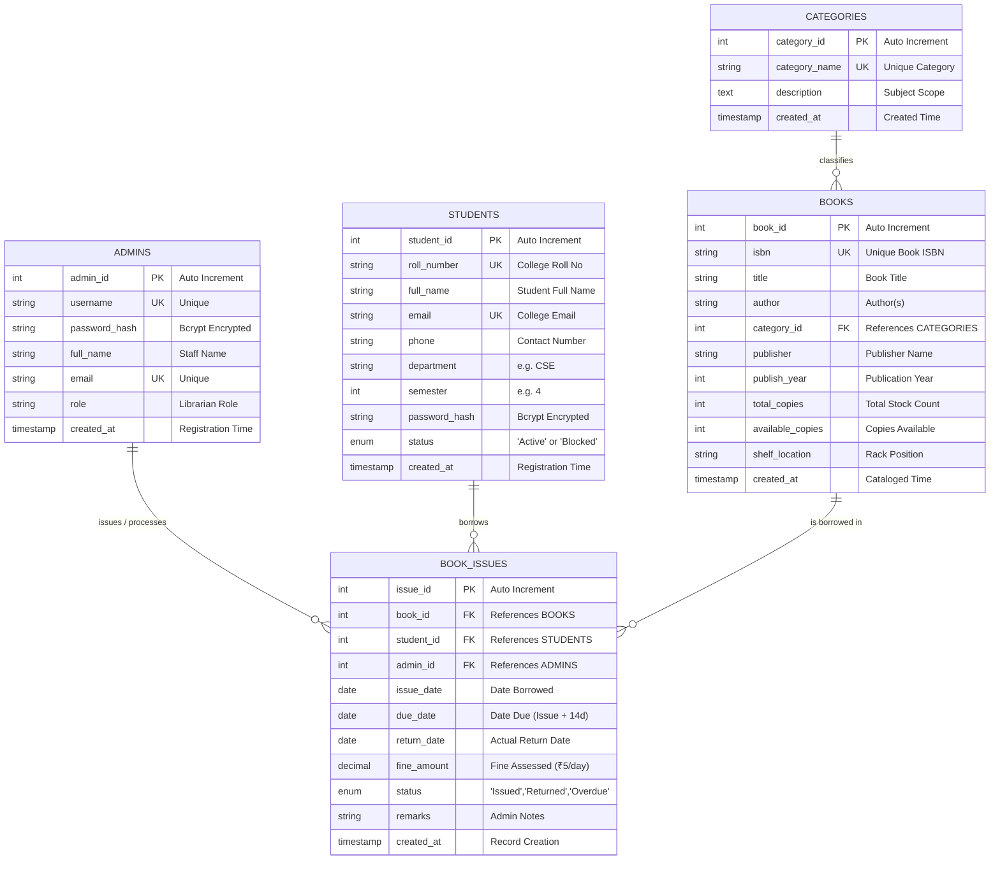

# 📊 Entity-Relationship (ER) Diagram & Database Schema
**Project:** Library Management System  
**Course:** Database Management Systems (2nd-Year B.Tech CSE)  
**Database Engine:** MySQL (InnoDB)

---

## 1. Mermaid ER Diagram



---

## 2. Entities, Relationships, and Cardinality Analysis

### A. Entities & Descriptions
1. **ADMINS**: Represents library administrative staff authorized to manage books, register/block students, and perform lending transactions.
2. **CATEGORIES**: Academic departments and disciplines (e.g., Computer Science, Data Science & AI, Discrete Mathematics).
3. **STUDENTS**: College students registered in the library system eligible to borrow books.
4. **BOOKS**: Physical book titles cataloged in the library with total and available stock.
5. **BOOK_ISSUES**: The associative/junction transaction entity linking students, books, and librarians with temporal tracking (issue, due, return dates) and late fees.

### B. Cardinality & Modality Ratios
| Relationship | Cardinality | Participation | Description |
|---|---|---|---|
| **Categories to Books** | `1 : N` (One-to-Many) | Mandatory (Books), Optional (Categories) | One category can contain multiple books; each book must belong to exactly one category. |
| **Students to Book_Issues** | `1 : N` (One-to-Many) | Partial (Students), Total (Book_Issues) | A student can borrow zero, one, or multiple books over time; each issue record must belong to a student. |
| **Books to Book_Issues** | `1 : N` (One-to-Many) | Partial (Books), Total (Book_Issues) | A book title can be checked out multiple times; each issue record references one book. |
| **Admins to Book_Issues** | `1 : N` (One-to-Many) | Partial (Admins), Total (Book_Issues) | An admin issues multiple books; each transaction records the issuing staff member. |
| **Students to Books** | `M : N` (Many-to-Many) | Resolved via Associative Entity | Students borrow many books; books are borrowed by many students. Resolved cleanly into `Book_Issues`. |

---

## 3. Relational Schema Notation

```text
Admins(
    admin_id [PK], 
    username [UK], 
    password_hash, 
    full_name, 
    email [UK], 
    role, 
    created_at
)

Categories(
    category_id [PK], 
    category_name [UK], 
    description, 
    created_at
)

Students(
    student_id [PK], 
    roll_number [UK], 
    full_name, 
    email [UK], 
    phone, 
    department, 
    semester, 
    password_hash, 
    status, 
    created_at
)

Books(
    book_id [PK], 
    isbn [UK], 
    title, 
    author, 
    category_id [FK -> Categories.category_id], 
    publisher, 
    publish_year, 
    total_copies, 
    available_copies, 
    shelf_location, 
    created_at
)

Book_Issues(
    issue_id [PK], 
    book_id [FK -> Books.book_id], 
    student_id [FK -> Students.student_id], 
    admin_id [FK -> Admins.admin_id], 
    issue_date, 
    due_date, 
    return_date, 
    fine_amount, 
    status, 
    remarks, 
    created_at
)
```

---

## 4. Normalization Walkthrough (1NF to 3NF and BCNF)

### Unnormalized Form (UNF)
Consider a flat spreadsheet table storing library circulation records:
`Library_Record(roll_no, student_name, student_email, book_isbn, book_title, authors, category_name, category_desc, issue_date, due_date)`

### Step 1: Conversion to First Normal Form (1NF)
- **Rule:** Attribute values must be **atomic** (no repeating groups, comma-separated lists, or arrays).
- **Violation in UNF:** Multiple authors in a single cell (e.g., `"Silberschatz, Galvin, Gagne"`).
- **Resolution:** Each attribute is strictly atomic.
- **Candidate Key of 1NF relation:** `{roll_no, book_isbn, issue_date}`.

### Step 2: Conversion to Second Normal Form (2NF)
- **Rule:** Must be in 1NF AND have **no Partial Functional Dependencies** (no non-prime attribute may depend on a proper subset of any candidate key).
- **Functional Dependencies identified:**
  - `FD1: {roll_no, book_isbn, issue_date} -> due_date` (Full Dependency on Composite Key)
  - `FD2: roll_no -> student_name, student_email` (Partial Dependency: depends only on `roll_no`)
  - `FD3: book_isbn -> book_title, category_name, category_desc` (Partial Dependency: depends only on `book_isbn`)
- **Resolution (Decomposition):** Separate into entities where attributes depend on the entire key:
  1. `Students(roll_no, student_name, student_email)`
  2. `Books(book_isbn, book_title, category_name, category_desc)`
  3. `Book_Issues(issue_id, roll_no, book_isbn, issue_date, due_date)`

### Step 3: Conversion to Third Normal Form (3NF)
- **Rule:** Must be in 2NF AND have **no Transitive Dependencies** (For every non-trivial FD $X \rightarrow Y$, either $X$ is a super key or $Y$ is a prime attribute).
- **Violation in 2NF Books Table:**
  - `book_isbn -> category_name`
  - `category_name -> category_desc`
  - Therefore, `book_isbn -> category_desc` is a **transitive dependency**! If all books in "Computer Science" are deleted, the description of "Computer Science" is lost (Deletion Anomaly).
- **Resolution:** Extract Categories into its own table:
  - `Categories(category_id, category_name, description)`
  - `Books(book_id, isbn, title, author, category_id, ...)`

### Step 4: Verification of Boyce-Codd Normal Form (BCNF)
- **Rule:** A relation is in BCNF if for **every** non-trivial functional dependency $X \rightarrow Y$, the determinant $X$ is a **Super Key**.
- **Proof for our Schema:**
  1. In `Categories`: Determinant `category_id` is a Super Key.
  2. In `Students`: Determinants `student_id` and `roll_number` are Candidate/Super Keys.
  3. In `Books`: Determinants `book_id` and `isbn` are Candidate/Super Keys.
  4. In `Book_Issues`: Determinant `issue_id` is a Super Key.
  5. In `Admins`: Determinants `admin_id` and `username` are Super Keys.
- **Conclusion:** Because no functional dependency exists where a non-super key determines any attribute, the database schema strictly satisfies **BCNF**.
